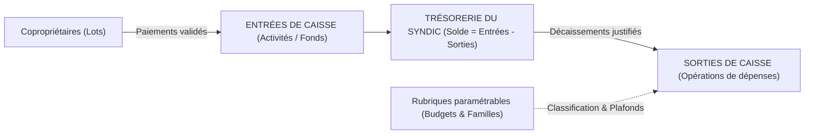

# Proposition : Gestion des Dépenses (Sorties de Caisse) & Trésorerie Entrées / Sorties

## 1. Analyse de l'existant et enjeux pour le Syndic

Actuellement, l'application gère le volet **Recettes (Entrées de caisse)** à travers les tables `activites` (ex. *Cotisation Sécurité & Entretien — 10 000 FCFA/mois*) et `paiements` dans [schema.sql](file:///c:/Antigravity/synco2/supabase/schema.sql) et [dataService.ts](file:///c:/Antigravity/synco2/src/services/dataService.ts).

Dans la réalité d'un syndic de cité résidentielle (comme la **Cité Ivoire 2**), **une même cotisation mensuelle globale finance de multiples postes de charges** (gardiennage, éclairage, propreté, voirie, administration…), auxquels peuvent s'ajouter des appels de fonds ponctuels (travaux exceptionnels).

> [!IMPORTANT]
> Pour assurer une comptabilité **Entrées / Sorties** rigoureuse et transparente en Assemblée Générale, il ne faut pas confondre les **Activités d'encaissement** (ce que paient les résidents) et les **Rubriques de dépenses** (comment le syndic utilise les fonds), tout en permettant de relier les deux pour calculer le **Solde réel disponible en caisse**.

---

## 2. Paramétrage des Rubriques de Dépenses (Couverture complète du Syndic)

Le syndic pourra **créer, modifier, activer/désactiver et supprimer** librement ses rubriques. Pour démarrer immédiatement avec une structure professionnelle couvrant toutes les activités d'une cité, **8 grandes familles / rubriques pré-paramétrées** seront livrées par défaut (et 100 % personnalisables) :

| Code | Rubrique pré-configurée | Icône | Famille comptable | Exemples d'opérations couvertes |
| :--- | :--- | :---: | :--- | :--- |
| `RUB_SEC` | **Sécurité & Gardiennage** | 🛡️ | Exploitation courante | Salaires/factures vigiles, équipements (torches, tenues, talkies), guérite, vidéosurveillance |
| `RUB_SALUB` | **Salubrité & Espaces Verts** | 🌿 | Exploitation courante | Ramassage ordures, balayage des voies, tonte/débroussaillage, curage caniveaux, désinsectisation |
| `RUB_ELEC` | **Éclairage Public, Eau & Énergie** | 💡 | Exploitation courante | Factures CIE / SODECI parties communes, ampoules, lampadaires solaires, interventions électricien |
| `RUB_VOIRIE` | **Voirie, Portail & Infrastructures** | 🛣️ | Travaux & Maintenance | Réparation pavés/nids-de-poule, dos d'âne, portail d'entrée, clôture, peinture bordures, plomberie |
| `RUB_ADMIN` | **Fonctionnement & Administration** | 📁 | Gestion & Frais | Impressions (reçus, notes, AG), fournitures, crédit com., frais Mobile Money / banque |
| `RUB_AG_JUR` | **Assemblées Générales & Juridique** | ⚖️ | Gestion & Frais | Location bâches/chaises AG, rafraîchissements, frais d'huissier, démarches mairie/ministère |
| `RUB_SOCIAL` | **Vie Sociale & Solidarité Cité** | 🤝 | Vie communautaire | Journée citoyenne, fête de la cité / arbre de Noël, assistance sociale selon règlement intérieur |
| `RUB_INVEST` | **Grands Travaux & Imprévus** | 🚨 | Investissement / Urgence | Dépenses d'urgence sur sinistre, projets d'investissement votés en AG |

### Propriétés paramétrables d'une Rubrique (`rubriques_depenses`)
- **Nom & Icône** : Identification visuelle rapide dans les listes et graphiques.
- **Famille comptable** : `exploitation` | `maintenance` | `administration` | `social` | `investissement`.
- **Budget mensuel indicatif (optionnel)** : Permet d'afficher une jauge de consommation budgétaire (ex. *Budget Sécurité : 450 000 FCFA / mois*) et d'alerter visuellement en cas de dépassement, sans bloquer une urgence.
- **Statut** : `actif` ou `inactif` (pour archiver une ancienne rubrique sans perdre l'historique comptable).
- **Description** : Précisions sur ce que couvre la rubrique.

---

## 3. Enregistrement d'une Opération de Dépense (Sortie de Caisse)

Chaque sortie de caisse enregistrée dans la table `depenses` comportera les informations indispensables à la justification comptable du syndic :

| Champ | Type / Valeurs | Utilité métier |
| :--- | :--- | :--- |
| `id` | `DEP-YYYY-XXXX` | Numéro interne unique de l'écriture |
| `date` | `DATE` | Date effective du décaissement |
| `rubrique_id` | Réf. `rubriques_depenses` | **Obligatoire** — Poste de dépense imputé |
| `activite_id` | Réf. `activites` *(optionnel)* | Source de financement (par défaut *Cotisation Sécurité & Entretien*, ou une cotisation travaux dédiée) |
| `secteur_id` | Réf. `secteurs` *(optionnel)* | `Toute la cité (Commun)` par défaut, ou rattaché à un secteur précis (ex. réparation dans le Secteur 2) |
| `libelle` | `TEXT` | Motif précis (ex. *Règlement prestation gardiennage Octobre 2026*) |
| `montant` | `NUMERIC` (FCFA) | Montant décaissé |
| `beneficiaire` | `TEXT` | Prestataire, fournisseur ou agent payé (ex. *Ivoire Sécurité*, *CIE*, *M. Koné Électricien*) |
| `mode_paiement` | `TEXT` | `Espèces (Caisse)`, `Wave`, `Orange Money`, `MTN MoMo`, `Chèque`, `Virement bancaire` |
| `reference_piece`| `TEXT` | N° de facture, N° de reçu papier ou ID transaction Mobile Money |
| `statut` | `valide` \| `en_attente` \| `rejete` | Permet un contrôle interne (validation par l'Admin si saisi par un Responsable) |
| `enregistre_par` | `TEXT` | Traçabilité de l'auteur de la saisie |
| `valide_par` | `TEXT` | Traçabilité du responsable/trésorier ayant approuvé la sortie |
| `note` | `TEXT` | Observation complémentaire |

> [!TIP]
> **Sécurité comptable** : Une rubrique contenant déjà des dépenses historiques ne pourra pas être supprimée par erreur (`ON DELETE RESTRICT`) ; l'application proposera plutôt de la passer en statut `inactif`. De même, un avertissement s'affichera lors de la saisie si le montant dépasse le **solde disponible en caisse**.

---

## 4. Intégration dans l'Interface & Gestion Entrées / Sorties

### A. Nouvel espace « Dépenses & Caisse » dans [Navbar.tsx](file:///c:/Antigravity/synco2/src/components/Navbar.tsx)
Un nouvel onglet dédié avec **2 sous-onglets** :
1. **Journal des Sorties de Caisse** :
   - **Bandeau Trésorerie temps réel** : *Total Entrées Validées* | *Total Sorties Validées* | **Solde Net Disponible en Caisse** | *Dépenses du mois*.
   - **Filtres multicritères** : Période (du / au), Rubrique, Secteur, Mode de règlement, Statut, Recherche libre (libellé, bénéficiaire, N° pièce).
   - **Actions** : Enregistrer une dépense, Modifier, Valider/Rejeter, Supprimer (avec modale de confirmation), Imprimer un **Bon de Sortie de Caisse** ou la liste filtrée.
2. **Paramétrage des Rubriques** :
   - Cartes visuelles avec icône, budget mensuel prévu vs consommé sur le mois en cours.
   - Création / Modification / Activation des rubriques via modale dédiée.

### B. Mise à jour du Tableau de Bord ([AdminDashboard.tsx](file:///c:/Antigravity/synco2/src/components/admin/AdminDashboard.tsx))
- Ajout du KPI **Solde en Caisse (Entrées − Sorties)** et **Total Dépensé** pour que le bureau du syndic voie immédiatement la trésorerie réelle disponible.
- Aperçu combiné des derniers mouvements ou accès direct à la saisie de dépense.

### C. Bilan Trésorerie Entrées / Sorties dans [RapportsView.tsx](file:///c:/Antigravity/synco2/src/components/rapports/RapportsView.tsx)
Ajout d'un onglet **« Bilan Entrées / Sorties (PDF) »** imprimable en A4 officiel (idéal pour les réunions de bureau et Assemblées Générales) comprenant sur une période choisie :
1. **Résumé de Trésorerie** : Report solde antérieur (avant la période) + Entrées de la période − Sorties de la période = **Solde final en caisse**.
2. **Ventilation des Entrées** par activité et par secteur.
3. **Ventilation des Sorties** par rubrique de dépense (avec % du total et comparaison au budget).
4. **Grand livre chronologique des dépenses** de la période avec références des pièces justificatives et encadré de signatures (*Trésorier / Président du Syndic / Commissaire aux comptes*).

---

## 5. Fichiers techniques qui seront créés ou mis à jour

- **Base de données & Types** :
  - Nouvelle migration SQL `supabase/migrations/20261103000000_depenses_et_rubriques.sql` + mise à jour de [schema.sql](file:///c:/Antigravity/synco2/supabase/schema.sql).
  - Ajout des types `RubriqueDepense`, `Depense`, `FamilleRubrique`, `DepenseStatut` dans [database.ts](file:///c:/Antigravity/synco2/src/types/database.ts).
  - Rubriques par défaut dans [initialData.ts](file:///c:/Antigravity/synco2/src/lib/initialData.ts) et méthodes CRUD (Supabase + fallback `localStorage`) dans [dataService.ts](file:///c:/Antigravity/synco2/src/services/dataService.ts).
- **Composants UI & Modales** :
  - `src/components/admin/DepensesView.tsx` (Journal des sorties + Onglet Paramétrage des rubriques).
  - `src/components/modals/AddEditDepenseModal.tsx` & `src/components/modals/AddEditRubriqueModal.tsx`.
  - `src/components/rapports/BilanTresorerieModule.tsx` (État financier Entrées/Sorties imprimable A4) branché dans [RapportsView.tsx](file:///c:/Antigravity/synco2/src/components/rapports/RapportsView.tsx).
  - Mise à jour de [AdminDashboard.tsx](file:///c:/Antigravity/synco2/src/components/admin/AdminDashboard.tsx), [RapportsFinanciers.tsx](file:///c:/Antigravity/synco2/src/components/admin/RapportsFinanciers.tsx), [Navbar.tsx](file:///c:/Antigravity/synco2/src/components/Navbar.tsx) et [page.tsx](file:///c:/Antigravity/synco2/src/app/page.tsx).
